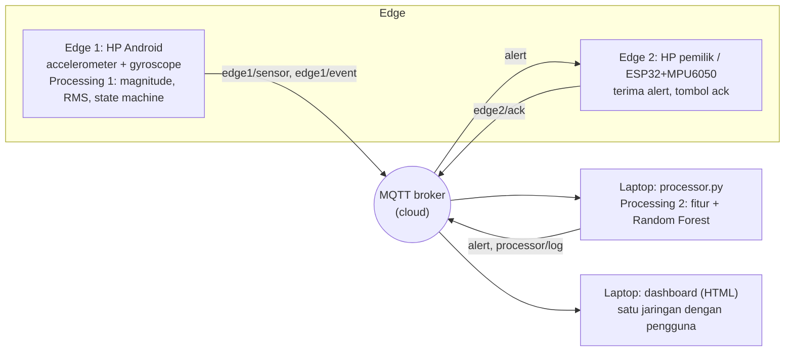

# FallGuard — Pendeteksi Jatuh Berbasis IoT Edge + MQTT

> Tugas IoT · Kelompok **11** · Anggota: **Chayara Alima Ramadhani - 
Al Ma'lufi - 
Intan Zahra Amartin**

FallGuard mendeteksi jatuh memakai **accelerometer + gyroscope** pada HP Android yang dibawa pengguna.
HP memproses sinyal di perangkat (edge), mengirimkannya lewat **MQTT** ke cloud, lalu sebuah
**processor di laptop** mengonfirmasi dengan **Random Forest**. Alert diterima pemilik/penjaga
(HP kedua atau ESP32 berbuzzer) dan tampil di **dashboard** pada jaringan yang sama dengan pengguna.

**Masalah:** orang lanjut usia yang jatuh sendirian sering terlambat ditolong.
**Pembeda ide:** Konfirmasi dua tahap untuk menekan alarm palsu, tombol "saya aman"


## Arsitektur



| Syarat tugas | Pemenuhan |
|---|---|
| ≥ 2 edge device | Edge 1 = HP Android, Edge 2 = HP kedua atau ESP32 |
| ≥ 2 sensor | Accelerometer + gyroscope (HP; ESP32 memakai MPU6050) |
| ≥ 2 jenis data processing | (1) di HP: decimation 20 Hz, magnitude, RMS, state machine; (2) di laptop: ekstraksi 9 fitur + klasifikasi Random Forest |
| Algoritma AI / lain | Random Forest (`ml/train.py`), pembanding: aturan threshold |
| Protokol ke cloud | MQTT (WebSocket dari browser, TCP dari Python/ESP32) |
| Dashboard satu jaringan | `dashboard/` disajikan laptop di LAN |

## Cara kerja deteksi (dua tahap)

1. **Tahap edge (HP):** HP mencari pola *free-fall → impact → diam* (atau impact + rotasi kuat lalu diam).
   Bila cocok, HP mengirim `edge1/event` (`POSSIBLE_FALL`).
2. **Tahap konfirmasi (laptop):** processor mengambil window 4 detik di sekitar impact dari buffer sensor,
   menghitung 9 fitur (`mag_max, mag_min, mag_mean, mag_std, mag_rms, gyro_max, gyro_mean, post_std, tilt_change_deg`),
   lalu Random Forest memutuskan. Jika `ml/model.pkl` belum ada, processor memakai replay aturan sebagai
   pendapat kedua. Hanya yang terkonfirmasi dipublikasikan ke topic `alert`.

## Topic MQTT

Semua topic berawalan `fallguard/<PROJECT_ID>/`.

| Topic | Pengirim → Penerima | Isi |
|---|---|---|
| `edge1/sensor` | HP → processor, dashboard | `{device,t,ax,ay,az,mag,gyro,rms,state}` 20 Hz |
| `edge1/event` | HP → processor, dashboard | `{type:"POSSIBLE_FALL",t,t_impact,had_freefall,gyro_peak,still_std}` |
| `alert` | processor → Edge 2, dashboard | `{device,type:"FALL",t_impact,t_alert,confidence,source,processing_ms}` |
| `processor/log` | processor → dashboard | keputusan `FALL` / `REJECTED` |
| `edge2/sensor` | ESP32 → dashboard, processor | sensor MPU6050 (opsional) |
| `edge2/ack` | Edge 2 → dashboard | konfirmasi "saya aman" |
| `*/status` | semua | `online` / `offline` (retained + last will) |

> Broker publik **tidak privat**. Gunakan `PROJECT_ID` yang unik, jangan kirim data pribadi, dan jangan aktifkan GPS.

## Menjalankan

Pilih satu `PROJECT_ID` unik (mis. `kel7-fall-8f3a`) dan pakai di semua perangkat.

**1. Hosting halaman HP (sekali saja).** Push repo ke GitHub → *Settings → Pages →* branch `main`, folder `/ (root)`.
Halaman dapat dibuka di `https://argmntfii.github.io/fall-guard-iot/edge1-phone/` dan `.../edge2-phone/alert.html`.
HTTPS wajib agar browser mengizinkan sensor gerak.

**2. Processor (laptop).**
```bash
cd processor
python -m venv .venv && source .venv/bin/activate      # Windows: .venv\Scripts\activate
pip install -r requirements.txt
export FALLGUARD_PROJECT=kel7-fall-8f3a                # Windows PowerShell: $env:FALLGUARD_PROJECT="kel7-fall-8f3a"
python processor.py
```

**3. Dashboard (laptop).**
```bash
cd dashboard
python -m http.server 8000
```
Buka `http://localhost:8000` (atau `http://<IP-laptop>:8000` dari perangkat lain di WiFi yang sama),
isi `PROJECT_ID`, klik **Hubungkan**.

**4. Edge 1 (HP Android).** Buka halaman `edge1-phone`, isi `PROJECT_ID`, tekan **Mulai**, izinkan sensor,
taruh HP di saku/pinggang dan jaga layar tetap menyala.

**5. Edge 2.** Pilih salah satu:
- HP kedua: buka `edge2-phone/alert.html`, isi `PROJECT_ID`, tekan **Aktifkan**.
- ESP32: lihat `edge2-esp32/edge2.ino` (salin `secrets.h.example` → `secrets.h`).

**Debug:** buka [MQTTX Web](https://mqttx.app/web) → subscribe `fallguard/<PROJECT_ID>/#`.

## Melatih model AI

1. Dengan HP aktif dan `PROJECT_ID` sama, rekam data berlabel (lakukan jatuh **di kasur/bantal**, jangan pada orang):
   ```bash
   cd ml && pip install -r requirements.txt
   python record.py fall_depan --seconds 10     # jatuh sekali di tengah rekaman
   python record.py fall_belakang --seconds 10
   python record.py fall_samping --seconds 10
   python record.py adl_jalan --seconds 20
   python record.py adl_duduk --seconds 10
   python record.py adl_lompat --seconds 15
   python record.py adl_drop --seconds 10      # HP dijatuhkan ke meja
   ```
   Target awal: ≥ 10 rekaman `fall_*` dan ≥ 15 rekaman `adl_*`, bervariasi orang dan posisi HP.
2. `python train.py` → menghasilkan `ml/model.pkl`, `ml/model_info.json`, dan `docs/confusion_matrix.png`.
3. Restart `processor.py`; ia otomatis memakai model.

## Kalibrasi

Ambang bawaan (`impact 18 m/s²`, `free-fall 4 m/s²`, `std diam 1,2`, `gyro min 2 rad/s`) hanyalah titik awal.
Ubah dari panel **Ambang deteksi** di halaman Edge 1 setelah melihat data nyata di dashboard.
Nilai sensor tidak pernah disimulasikan: bila HP tidak punya sensor, halaman hanya menampilkan peringatan.

## Pengujian

```bash
cd processor && pip install pytest && pytest        # 15 uji (state machine, fitur, alur processor)
node edge1-phone/detector.test.js                   # uji state machine versi JS
```
## Struktur repo

```
fall-guard-iot/
├── edge1-phone/        halaman HP: sensor + processing 1 + publish MQTT
├── edge2-phone/        halaman penerima alert (HP kedua)
├── edge2-esp32/        sketch ESP32 + MPU6050 + buzzer (opsional)
├── processor/          processing 2 di laptop (konfirmasi + AI) + unit test
├── ml/                 rekam data, training, data CSV, model.pkl
├── dashboard/          dashboard web (HTML + Chart.js + mqtt.js)
└── docs/               presentasi, hasil uji, screenshot
```

## Keterbatasan

- Browser harus tetap terbuka dengan layar menyala; sensor berhenti bila tab di-background.
- Posisi HP (saku vs tas) memengaruhi sinyal; model dilatih pada posisi yang sama dengan penggunaan.
- Broker publik tidak punya jaminan layanan maupun privasi.
- Sketch ESP32 belum diuji pada semua varian board; sesuaikan pin.
